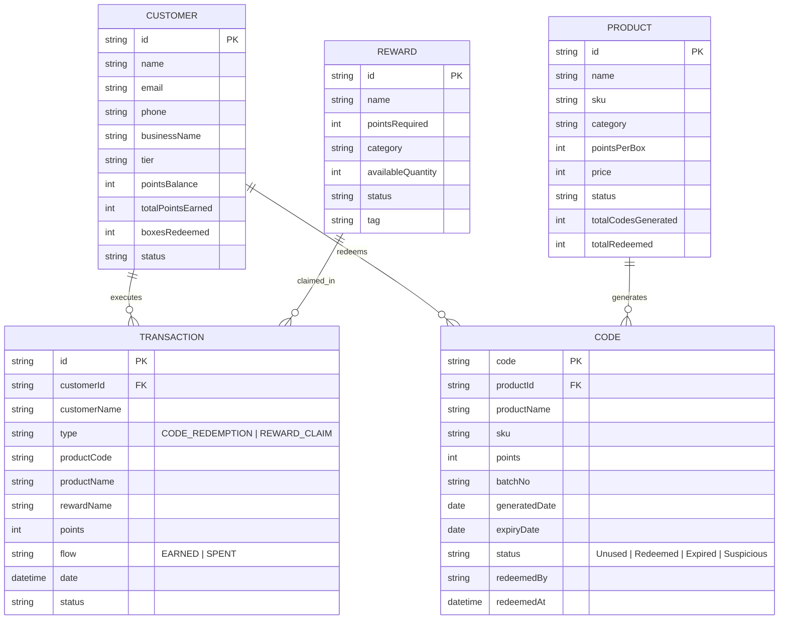
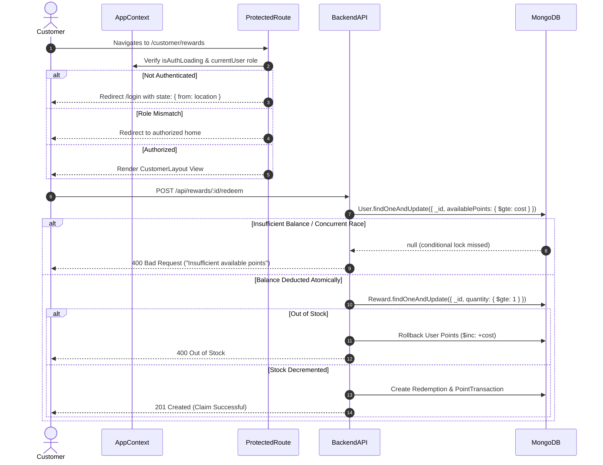

# ARCHITECTURE.md — System Design & Data Architecture

## 1. Architectural Overview & Stack Selection

The **LOYALTYBOX** system is engineered as an enterprise-grade, multi-tier platform cleanly decoupled between Frontend (Agent 1) and Backend (Agent 2):

### Frontend Stack (Agent 1)
- **React 19 + Vite 8**: Ultra-fast hot module replacement, predictable component tree rendering, and lightweight modern production bundles.
- **Tailwind CSS v4 + `@tailwindcss/vite`**: Zero-overhead utility-first stylesheet engine using modern `@theme` design tokens and strict Neo-Brutalist borders (`2px solid #000`), hard shadows (`4px 4px 0px 0px #000`), and tactile physical push buttons.
- **React Router DOM v7**: Declarative client-side nested routing separating Public, Customer Portal, and Factory Owner Admin layouts.
- **Recharts**: Responsive SVG charting library rendering area curves, growth bars, and redemption yield analytics.
- **React Hot Toast**: Unobtrusive, customized Neo-Brutalist notification toasts for real-time interaction feedback.
- **Canvas-Confetti**: High-delight micro-interaction upon successful code redemption and reward claiming.

### Backend Stack (Agent 2)
- **Node.js (ES Modules) & Express.js**: RESTful API server with modular routing, centralized error handling, and structured response contracts.
- **MongoDB & Mongoose**: Document database storing 10 distinct collections with optimized compound and unique indexes.
- **HMAC-SHA256 Cryptographic Engine**: Keyed code hashing ensuring zero plaintext code storage in the database.
- **Security & Protection**: Helmet HTTP headers, CORS whitelisting, express-rate-limit throttling, bcrypt password hashing, and JWT token rotation.
- **Testing**: Jest, Supertest, and MongoMemoryServer for hermetic automated integration tests.

---

## 2. Component & Layout Architecture

```mermaid
graph TD
    App[App.jsx - Root Router & AppProvider] --> PL[PublicLayout]
    App --> CL[CustomerLayout]
    App --> AL[AdminLayout]

    subgraph Public Routes
        PL --> Landing[LandingPage /]
        PL --> Login[LoginPage /login]
        PL --> Register[RegisterPage /register]
        PL --> Forgot[ForgotPasswordPage /forgot-password]
    end

    subgraph Customer Portal
        CL --> CDash[CustomerDashboard /customer/dashboard]
        CL --> CRedeem[RedeemCodePage /customer/redeem-code]
        CL --> CPoints[MyPointsPage /customer/points]
        CL --> CRewards[RewardsPage /customer/rewards]
        CL --> CHistory[RedemptionHistoryPage /customer/history]
        CL --> CSupport[CustomerSupport /customer/support]
        CL --> CProfile[CustomerProfilePage /customer/profile]
    end

    subgraph Factory Admin Portal
        AL --> ADash[AdminDashboard /admin/dashboard]
        AL --> ACust[CustomerManagement /admin/customers]
        AL --> AProd[ProductManagement /admin/products]
        AL --> ACodes[CodeManagement /admin/codes]
        AL --> ARew[RewardsManagement /admin/rewards]
        AL --> AFulfill[RewardFulfillment /admin/fulfillment]
        AL --> ACamp[CampaignManagement /admin/campaigns]
        AL --> ARed[RedemptionManagement /admin/redemptions]
        AL --> AFraud[FraudMonitoring /admin/fraud-monitoring]
        AL --> ASupp[AdminSupport /admin/support]
        AL --> AAudit[AdminAuditTrail /admin/audit-trail]
        AL --> AAnal[Analytics /admin/analytics]
        AL --> ASett[AdminSettings /admin/settings]
    end

    AppContext[(AppContext - LocalStorage Synchronized State)] -.-> CL
    AppContext -.-> AL
```

---

## 3. Data Entities & State Model

---

## 4. Neo-Brutalist Design Tokens

| Property | Token Value | Purpose |
|---|---|---|
| Primary Yellow | `#ffe17c` | High-energy accent, primary CTAs, highlight badges |
| Deep Charcoal | `#171e19` | Contrast panels, admin navigation, dark text |
| Sage Accent | `#b7c6c2` | Secondary cards, subtle borders, tags |
| White | `#ffffff` | Clean foreground card backgrounds |
| Black | `#000000` | Borders, typography, hard shadows |
| Border Width | `2px solid #000000` | Applied to all inputs, cards, and buttons |
| Standard Shadow | `4px 4px 0px 0px #000000` | Tactile Neo-Brutalist elevation |
| Large Shadow | `8px 8px 0px 0px #000000` | Main feature cards and modals |
| Container Shadow | `12px 12px 0px 0px #000000`| Prominent dashboard containers |
| Button Push Effect | `translate(2px, 2px)` | Pressed state removes shadow to mimic tactile switch |

---

## 5. Security & Concurrency Architecture (Phase 2 Remediation)

### Key Architectural Defenses:
1. **Zero-Trust Frontend Guard (`ProtectedRoute.jsx`)**: Authentication state is checked before rendering any child component; layout level checks in `AdminLayout` and `CustomerLayout` provide defense-in-depth against role bypass.
2. **Atomic Document Conditions**: Solves distributed race conditions in MongoDB without requiring external distributed locks. By placing balance and stock bounds (`{ availablePoints: { $gte: pointsRequired } }`) directly in the write filter, double-spend attacks are completely blocked.
3. **Automatic 401 Interceptor with Subscriber Queue (`api.js`)**: Serializes concurrent unauthorized requests into a pending queue while the refresh token is exchanged once, preventing token rotation collisions and infinite refresh loops.
4. **Defense Against ReDoS & Injection (`securityUtils.js`)**: All user-supplied search parameters are passed through `escapeRegex` before reaching Mongo `$regex` expressions, truncating over-length inputs and escaping all 14 RegExp special characters.
