# LOYALTYBOX Database Schema & Architecture

This document details the complete MongoDB data collections, indexes, and entity relationships managed by Mongoose for the **LOYALTYBOX** enterprise loyalty application, including all five master feature enhancement modules.

---

## 1. Entity Relationship Diagram (ERD)

```mermaid
erDiagram
    User ||--o{ PointTransaction : has_many
    User ||--o{ Redemption : claims
    User ||--o{ ProductCode : redeems
    User ||--o{ RefreshToken : owns
    User ||--o{ FraudLog : flagged_in
    User ||--o{ SupportTicket : opens
    Product ||--o{ ProductCode : generates
    Product ||--o{ CodeBatch : batched_in
    Product ||--o{ Campaign : targeted_by
    Reward ||--o{ Redemption : fulfilled_by
    AdminUser ||--o{ AuditLog : performs
    SupportTicket ||--o{ SupportMessage : contains
    FraudLog ||--o{ InvestigationNote : tracks
    Redemption ||--o{ FulfillmentTimeline : progresses

    User {
        ObjectId _id PK
        string fullName
        string email UK
        string phone
        string password "bcrypt hash"
        string role "customer | admin"
        int availablePoints
        int totalPointsEarned
        int totalPointsRedeemed
        int boxesRedeemed
        string tier "Bronze | Silver | Gold VIP | Platinum Elite"
        string businessName
        string city
        string state
        string status "active | suspended"
        datetime createdAt
    }

    Product {
        ObjectId _id PK
        string productName
        string sku UK
        string category
        int pointsPerBox
        int price
        string status "active | inactive"
        int totalCodesGenerated
        int totalRedeemed
    }

    ProductCode {
        ObjectId _id PK
        string codeHash UK "HMAC-SHA256 keyed hash"
        string codePrefix "BOX"
        ObjectId productId FK
        string batchId
        int points
        string status "unused | redeemed | expired | blocked"
        datetime generatedAt
        datetime expiresAt
        ObjectId redeemedBy FK
        datetime redeemedAt
    }

    Reward {
        ObjectId _id PK
        string name
        int pointsRequired
        int quantity
        string category "Coupons | Physical Products | Safety Gear | Merchandise | Exclusive Gifts | Gift Cards | Services"
        string tag
        string status "active | inactive"
    }

    Redemption {
        ObjectId _id PK
        ObjectId userId FK
        ObjectId rewardId FK
        string rewardName
        int pointsSpent
        string redemptionCode UK
        string status "Pending | Approved | Processing | Shipped | Delivered | Rejected"
        string trackingNumber
        string carrier
        date expectedDeliveryDate
        string deliveryAddress
        string rejectionReason
        string adminNotes
        array timeline "FulfillmentTimeline subdocuments"
        datetime createdAt
    }

    Campaign {
        ObjectId _id PK
        string title
        string description
        string campaignType "Double Points | Bonus Points | Festival Campaign | Limited-Time Campaign | New Customer Campaign"
        float multiplier
        int bonusPoints
        datetime startDate
        datetime endDate
        string status "Draft | Active | Paused | Ended"
        array eligibleProducts "ObjectId[] FK to Product"
        boolean allowStacking
        string bannerText
        int totalRedemptionsCount
        int totalBonusAwarded
        ObjectId createdBy FK
    }

    FraudLog {
        ObjectId _id PK
        ObjectId userId FK
        string customerName
        string email
        string eventType
        string riskLevel "Low | Medium | High | Critical"
        int riskScore "0 - 100 heuristic risk score"
        string ipAddress
        string userAgent
        string description
        string status "Pending Review | Under Review | Resolved | False Positive | Blacklisted"
        array investigationNotes "InvestigationNote subdocuments"
        datetime createdAt
    }

    SupportTicket {
        ObjectId _id PK
        string ticketId UK
        ObjectId userId FK
        string customerName
        string customerEmail
        string issueCategory "Code Scan Issue | Reward Delivery | Points Dispute | Account Access | Other"
        string subject
        string description
        string relatedProductCode
        string relatedRedemptionId
        string priority "Low | Medium | High | Urgent"
        string status "Open | In Progress | Waiting for Customer | Resolved | Closed"
        array messages "SupportMessage subdocuments (with isInternalNote flag)"
        datetime createdAt
        datetime updatedAt
    }

    AuditLog {
        ObjectId _id PK
        ObjectId adminId FK
        string adminName
        string adminEmail
        string actionType "CREATE_PRODUCT | UPDATE_FULFILLMENT | GENERATE_CODES | BLOCK_CUSTOMER | etc."
        string module "Products | Rewards | Redemptions | Fraud | Campaigns | Support | Settings"
        ObjectId targetId
        string description
        string ipAddress
        string userAgent
        object metadata "Sanitized audit payload"
        datetime createdAt
    }

    Setting {
        ObjectId _id PK
        string key UK "global_config"
        string plantName
        string plantCode
        int pointsExpiryMonths
        int defaultPointsPerBox
        int maxScansPerMinute
        boolean codeRedemptionEnabled
    }
```

---

## 2. Collections and Schema Details

### 2.1 AuditLog Schema (`backend/src/models/AuditLog.js`)
Tracks all mutating operator activity across the administrative portal:
- `adminId`: `ObjectId` referencing `User` (Indexed)
- `adminName`: Full display name of the operator
- `adminEmail`: Email of the operator
- `actionType`: Verb tag, e.g. `CREATE_PRODUCT`, `UPDATE_FULFILLMENT`, `GENERATE_CODES`
- `module`: Target system module, e.g. `Products`, `Rewards`, `Redemptions`, `Fraud`, `Campaigns`, `Settings` (Indexed)
- `targetId`: `ObjectId` or string identifier of modified resource
- `description`: Plain English human-readable audit entry
- `ipAddress`: Client IPv4/IPv6 address
- `userAgent`: Client User-Agent string
- `metadata`: Sanitized JSON payload (passwords, tokens, and secrets automatically redacted)
- `createdAt`: Timestamp with descending index for sub-millisecond pagination

### 2.2 Campaign Schema (`backend/src/models/Campaign.js`)
Defines marketing boost and multiplier campaigns:
- `title`: Short campaign title
- `description`: Marketing rules and details
- `campaignType`: Enum: `'Double Points'`, `'Bonus Points'`, `'Festival Campaign'`, `'Limited-Time Campaign'`, `'New Customer Campaign'`
- `multiplier`: Float multiplier applied to base product points (default 1)
- `bonusPoints`: Flat points bonus added per code scan (default 0)
- `startDate` & `endDate`: Timeframe during which scan bonus is active
- `status`: Enum: `'Draft'`, `'Active'`, `'Paused'`, `'Ended'`
- `eligibleProducts`: Array of `Product` ObjectIds (empty array signifies all SKUs eligible)
- `bannerText`: Customer dashboard notification copy
- `totalRedemptionsCount`: Atomic counter incremented per code scan under campaign
- `totalBonusAwarded`: Total extra points awarded to customers under campaign

### 2.3 SupportTicket Schema (`backend/src/models/SupportTicket.js`)
Two-way customer disputes and inquiry ticketing:
- `ticketId`: Unique alphanumeric reference code (e.g. `TICK-2026-8812`)
- `userId`: Customer `ObjectId` reference (Indexed)
- `customerName` & `customerEmail`: Customer identity
- `issueCategory`: Enum: `'Code Scan Issue'`, `'Reward Delivery'`, `'Points Dispute'`, `'Account Access'`, `'Other'`
- `subject`: Ticket headline
- `description`: Detailed description
- `relatedProductCode` & `relatedRedemptionId`: Cross references to codes or fulfillment orders
- `priority`: Enum: `'Low'`, `'Medium'`, `'High'`, `'Urgent'`
- `status`: Enum: `'Open'`, `'In Progress'`, `'Waiting for Customer'`, `'Resolved'`, `'Closed'`
- `messages`: Embedded array of conversation messages:
  - `senderId`: `ObjectId`
  - `senderName`: String
  - `senderRole`: `'customer' | 'admin'`
  - `message`: Text content
  - `isInternalNote`: Boolean (filtered out from customer views; private to staff)
  - `createdAt`: Date

### 2.4 Extended Redemption Schema (`backend/src/models/Redemption.js`)
Extended with end-to-end fulfillment tracking:
- `status`: Enum: `'Pending'`, `'Approved'`, `'Processing'`, `'Shipped'`, `'Delivered'`, `'Rejected'`
- `trackingNumber`: Carrier tracking code (e.g. `BD-99882233`)
- `carrier`: Shipping provider (e.g. `BlueDart Express`, `Delhivery`, `DTDC`)
- `expectedDeliveryDate`: Projected delivery date
- `deliveryAddress`: Shipping destination address
- `rejectionReason`: Required justification if rejected (triggers atomic point refund)
- `adminNotes`: Internal fulfillment notes
- `timeline`: Embedded history of status transitions with timestamps and operator notes

### 2.5 Extended FraudLog Schema (`backend/src/models/FraudLog.js`)
Extended with deterministic threat scoring and forensic notes:
- `riskScore`: Computed integer (0–100) from rule-based risk heuristic engine
- `riskLevel`: Derived categorization (`'Low'`, `'Medium'`, `'High'`, `'Critical'`)
- `status`: Enum: `'Pending Review'`, `'Under Review'`, `'Resolved'`, `'False Positive'`, `'Blacklisted'`
- `investigationNotes`: Embedded array of notes added by security analysts:
  - `note`: Forensic note text
  - `adminId` & `adminName`: Investigator identity
  - `createdAt`: Date

---

## 3. Indexes and Performance Optimizations

| Collection | Indexed Fields | Index Type | Purpose |
|---|---|---|---|
| `users` | `email` | Unique | Prevent duplicate account creation |
| `products` | `sku` | Unique | Enforce unique physical SKU identifiers |
| `productCodes` | `codeHash` | Unique | O(1) instant cryptographic verification lookup |
| `productCodes` | `{ codeHash: 1, status: 1 }` | Compound | Fast atomic verification and redemption queries |
| `productCodes` | `{ batchId: 1, status: 1 }` | Compound | Rapid batch audit and CSV reporting |
| `pointTransactions` | `{ userId: 1, createdAt: -1 }` | Compound | Instant retrieval of customer ledger records |
| `redemptions` | `{ userId: 1, createdAt: -1 }` | Compound | Fast customer order history retrieval |
| `redemptions` | `{ status: 1, createdAt: -1 }` | Compound | Admin fulfillment pipeline queue triage |
| `campaigns` | `{ status: 1, startDate: 1, endDate: 1 }` | Compound | Rapid lookup of active promotional campaigns during code scan |
| `supportTickets` | `{ userId: 1, createdAt: -1 }` | Compound | Fast customer support ticket history |
| `supportTickets` | `{ status: 1, priority: 1, createdAt: -1 }` | Compound | Admin support triage queue |
| `auditLogs` | `{ createdAt: -1 }` | Single | Sub-millisecond audit trail pagination |
| `auditLogs` | `{ module: 1, actionType: 1 }` | Compound | Filtering administrative activity by subsystem |
| `fraudLogs` | `{ riskScore: -1, createdAt: -1 }`| Compound | High-severity threat triage |
| `refreshTokens` | `expiresAt` | TTL Index | Automatic MongoDB database eviction of expired sessions |
