# LOYALTYBOX Database Schema & Architecture

This document details the MongoDB data collections, indexes, and entity relationships managed by Mongoose for the **LOYALTYBOX** backend.

---

## 1. Entity Relationship Diagram (ERD)

```mermaid
erDiagram
    User ||--o{ PointTransaction : has_many
    User ||--o{ Redemption : claims
    User ||--o{ ProductCode : redeems
    User ||--o{ RefreshToken : owns
    Product ||--o{ ProductCode : generates
    Product ||--o{ CodeBatch : batched_in
    Reward ||--o{ Redemption : fulfilled_by
    User ||--o{ FraudLog : audited_in

    User {
        ObjectId _id PK
        string fullName
        string email UK
        string phone
        string password "bcrypt hash"
        string role "customer | admin"
        int availablePoints
        int totalPointsEarned
        int totalPointsRedeemed
        int boxesRedeemed
        string tier "Bronze | Silver | Gold VIP | Platinum Elite"
        string businessName
        string city
        string state
        string status "active | suspended"
        datetime createdAt
    }

    Product {
        ObjectId _id PK
        string productName
        string sku UK
        string category
        int pointsPerBox
        int price
        string status "active | inactive"
        int totalCodesGenerated
        int totalRedeemed
    }

    ProductCode {
        ObjectId _id PK
        string codeHash UK "HMAC-SHA256 keyed hash"
        string codePrefix "BOX"
        ObjectId productId FK
        string batchId
        int points
        string status "unused | redeemed | expired | blocked"
        datetime generatedAt
        datetime expiresAt
        ObjectId redeemedBy FK
        datetime redeemedAt
    }

    CodeBatch {
        ObjectId _id PK
        string batchId UK
        ObjectId productId FK
        int count
        int points
        ObjectId generatedBy FK
        datetime expiresAt
    }

    Reward {
        ObjectId _id PK
        string name
        int pointsRequired
        int quantity
        string category
        string tag
        string status "active | inactive"
    }

    PointTransaction {
        ObjectId _id PK
        ObjectId userId FK
        string type "earned | redeemed | expired | adjusted"
        string flow "EARNED | SPENT"
        int points
        string source "CODE_REDEMPTION | REWARD_CLAIM | SIGNUP_BONUS"
        string referenceId
        string description
        datetime createdAt
    }

    Redemption {
        ObjectId _id PK
        ObjectId userId FK
        ObjectId rewardId FK
        string rewardName
        int pointsSpent
        string redemptionCode UK
        string status "pending | approved | dispatched | delivered"
        datetime createdAt
    }

    FraudLog {
        ObjectId _id PK
        ObjectId userId FK
        string eventType
        string riskLevel "Low | Medium | High | Critical"
        string ipAddress
        string userAgent
        string description
        string status "Pending Review | Resolved | Blacklisted"
        datetime createdAt
    }

    RefreshToken {
        ObjectId _id PK
        string tokenHash UK
        ObjectId userId FK
        datetime expiresAt "TTL index"
        boolean revoked
    }

    Setting {
        ObjectId _id PK
        string key UK "global_config"
        string plantName
        string plantCode
        int pointsExpiryMonths
        int defaultPointsPerBox
        int maxScansPerMinute
        boolean codeRedemptionEnabled
    }
```

---

## 2. Indexes and Performance Optimizations

| Collection | Indexed Fields | Index Type | Purpose |
|---|---|---|---|
| `users` | `email` | Unique | Prevent duplicate account creation |
| `products` | `sku` | Unique | Enforce unique physical SKU identifiers |
| `productCodes` | `codeHash` | Unique | O(1) instant cryptographic verification lookup |
| `productCodes` | `{ codeHash: 1, status: 1 }` | Compound | Fast atomic verification and redemption queries |
| `productCodes` | `{ batchId: 1, status: 1 }` | Compound | Rapid batch audit and CSV reporting |
| `pointTransactions` | `{ userId: 1, createdAt: -1 }` | Compound | Instant retrieval of customer ledger records |
| `redemptions` | `{ userId: 1, createdAt: -1 }` | Compound | Fast history retrieval |
| `fraudLogs` | `{ riskLevel: 1, createdAt: -1 }`| Compound | Priority security triage filtering |
| `refreshTokens` | `expiresAt` | TTL Index | Automatic MongoDB database eviction of expired sessions |
